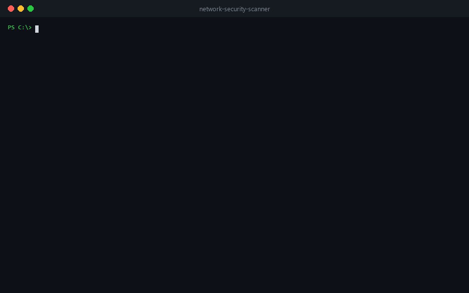

# Network Security Scanner: Python Port Scanner with CVE, CISA KEV & EPSS Prioritization

[](https://github.com/kapoordeepanshu/network-security-scanner/actions/workflows/tests.yml)


[](LICENSE)

**Network Security Scanner** (`netscanner`) is a free, open-source **network vulnerability scanner** written in pure Python. It scans an IP address, hostname or whole subnet for **open ports**, identifies the **services and versions** running on them (banner grabbing and TLS inspection), and highlights **security risks**. It looks up **known CVEs** and ranks them by what attackers are actually exploiting today (CISA KEV and EPSS), so you know **what to fix first**.

No dependencies, no root/admin rights, runs on Windows, macOS and Linux.



> ⚠️ **Only scan systems you own or have explicit written permission to test.** Unauthorized port scanning may be illegal in your country and violates most providers' terms of service. To practise legally, use [`scanme.nmap.org`](http://scanme.nmap.org) (which permits light scanning), [badssl.com](https://badssl.com) (deliberately broken TLS) or your own machines.

## Table of contents

- [Features](#features)
- [Quick start](#quick-start)
- [Installation](#installation)
- [Usage examples](#usage-examples)
- [Reports: console, HTML and JSON](#reports-console-html-and-json)
- [CVE lookup and prioritization](#cve-lookup-and-prioritization-kev--epss)
- [Continuous monitoring and CI/CD](#continuous-monitoring-and-cicd)
- [Command-line options](#command-line-options)
- [What it checks](#what-it-checks)
- [How it works](#how-it-works)
- [FAQ](#faq)
- [Contributing](#contributing)
- [License](#license)

## Features

- 🔍 **Fast multithreaded port scanner**: scan single hosts, hostnames, CIDR subnets (`192.168.1.0/24`), IP ranges (`10.0.0.1-50`) or a list of targets from a file.
- 🧬 **Service and version detection**: banner grabbing and protocol probes identify SSH, HTTP/HTTPS, FTP, SMTP, MySQL/MariaDB, Redis, VNC, Telnet, Elasticsearch, Docker and more, even on non-standard ports.
- 🛡️ **Security risk checks**: exposed databases and remote-access services, unauthenticated Redis, outdated or end-of-life software, expired or self-signed SSL/TLS certificates, deprecated TLS 1.0/1.1, weak ciphers and missing HTTP security headers.
- 🎯 **CVE lookup with real-world prioritization**: CVEs from the NIST NVD are ranked by **CISA Known Exploited Vulnerabilities (KEV)**, **EPSS** exploit probability and **CVSS** severity.
- 🔁 **Change detection**: compare scans over time to spot newly opened ports, new hosts and new vulnerabilities.
- 📊 **Interactive HTML report**: tabbed, filterable, searchable, dark mode, a single file that works offline. Also JSON and colored console output.
- 🚦 **CI/CD ready**: exit codes for failing builds on high-severity findings or unexpected changes.
- 📦 **Zero dependencies**: standard-library Python 3.9+. Also available as a Docker image.

## Quick start

```bash
git clone https://github.com/kapoordeepanshu/network-security-scanner.git
cd network-security-scanner

python -m netscanner scanme.nmap.org --cve --html report.html
```

Then open `report.html` in your browser (double-click it, `start report.html` on Windows, `open report.html` on macOS, `xdg-open report.html` on Linux).

👉 [**Live example report**](https://htmlpreview.github.io/?https://github.com/kapoordeepanshu/network-security-scanner/blob/main/docs/example-report.html), generated from a real scan of public test hosts.

## Installation

You need **Python 3.9 or newer** (`python --version`). Nothing else.

**Option 1: run from source (no install)**

```bash
git clone https://github.com/kapoordeepanshu/network-security-scanner.git
cd network-security-scanner
python -m netscanner --help
```

**Option 2: install the `netscanner` command with pip**

```bash
pip install git+https://github.com/kapoordeepanshu/network-security-scanner.git
netscanner --help
```

Using [pipx](https://pipx.pypa.io/) keeps it isolated: `pipx install git+https://github.com/kapoordeepanshu/network-security-scanner.git`

**Option 3: Docker**

```bash
docker build -t netscanner https://github.com/kapoordeepanshu/network-security-scanner.git
docker run --rm netscanner scanme.nmap.org -p 22,80
# save reports to the current folder
docker run --rm -v "$PWD:/out" netscanner 192.168.1.0/24 --html /out/report.html
```

> On Windows, use `python` (or `py`). On macOS/Linux you may need `python3` instead. If you didn't install with pip, replace `netscanner` with `python -m netscanner` in the examples below.

## Usage examples

```bash
# Scan one host on the 67 most common ports
netscanner 192.168.1.10

# Scan your whole home network and create an HTML report
netscanner 192.168.1.0/24 --html home-network.html

# Scan specific ports or ranges
netscanner example.com -p 22,80,443,8000-8100

# Scan all 65,535 TCP ports, faster
netscanner 10.0.0.5 -p all -w 500 -t 0.5

# Look up known CVEs (requires internet)
netscanner 192.168.1.1 --cve

# Scan targets listed in a file (one per line, # for comments)
netscanner -iL targets.txt --html report.html --json report.json

# Check SSL/TLS certificates of web servers
netscanner example.com -p 443,8443 --no-discovery
```

Finding your network range: run `ipconfig` (Windows) or `ip a` / `ifconfig` (Linux/macOS). If your IP is `192.168.1.23`, scan `192.168.1.0/24`.

## Reports: console, HTML and JSON

| Format | Flag | Best for |
|---|---|---|
| Colored console | *(default)* | Quick checks in the terminal |
| Interactive HTML | `--html report.html` | Sharing, reviewing, presenting. Tabs for **Overview**, **Findings**, **Hosts**, **Vulnerabilities** and **Changes**, with severity filters and search |
| JSON | `--json report.json` | Automation, SIEM import, scripting, and as a baseline for change detection |

Example console output from a real scan:

```
Host: 45.33.32.156 (scanme.nmap.org)
  PORT      SERVICE         VERSION / BANNER
  22/tcp    ssh             OpenSSH 6.6.1p1  [44 CVEs]
  80/tcp    http            Apache 2.4.7  [108 CVEs, 2 exploited]

  Findings:
   [CRITICAL] 80/tcp    Actively exploited vulnerability CVE-2021-40438
                        Apache 2.4.7: CVE-2021-40438 (CVSS 9.0, EPSS 100.0%, CISA KEV, ransomware) ...
                        -> Patch immediately: CISA lists this CVE as exploited in the wild.
   [HIGH]     22/tcp    44 known CVE(s) for OpenSSH 6.6.1p1
   [MEDIUM]   22/tcp    Outdated OpenSSH version
   [LOW]      80/tcp    Software version disclosed in HTTP headers
```

## CVE lookup and prioritization (KEV + EPSS)

Most scanners give you a long list of CVEs sorted by CVSS. In practice only a small fraction of CVEs are ever exploited. With `--cve`, netscanner combines three free public data sources:

| Source | What it tells you |
|---|---|
| [NIST NVD](https://nvd.nist.gov/developers/vulnerabilities) | Which CVEs affect the detected product version, and their CVSS score |
| [CISA KEV catalog](https://www.cisa.gov/known-exploited-vulnerabilities-catalog) | Whether the CVE is **known to be exploited in the wild**, and whether ransomware groups use it |
| [FIRST EPSS](https://www.first.org/epss/) | The **probability** that the CVE will be exploited in the next 30 days |

CVEs are sorted **exploited first → EPSS → CVSS**, and every KEV-listed CVE becomes a **CRITICAL** finding. Results are cached for 24 hours in `~/.cache/netscanner` (change the location with `NETSCANNER_CACHE`).

Lookups work without an account. A [free NVD API key](https://nvd.nist.gov/developers/request-an-api-key) makes them about 10× faster:

```bash
export NVD_API_KEY=your-key          # Windows PowerShell: $env:NVD_API_KEY="your-key"
netscanner 192.168.1.0/24 --cve
```

## Continuous monitoring and CI/CD

**Detect changes between scans.** Save a scan as JSON, then compare later scans against it:

```bash
netscanner 10.0.0.0/24 --json baseline.json                       # first scan
netscanner 10.0.0.0/24 --baseline baseline.json --fail-on-change  # later scans
```

```
Changes since baseline (2026-10-01T08:00:00+00:00):
  + port opened  10.0.0.23:3389 (rdp)
  + new finding  10.0.0.23:3389 [HIGH] RDP exposed
  - resolved     10.0.0.5:23 [HIGH] Telnet exposed
```

**Fail a pipeline on risky findings:**

```bash
netscanner staging.example.com --cve --fail-on high   # exit code 2 if HIGH or CRITICAL found
```

A ready-to-use nightly **GitHub Actions** workflow with change detection and HTML report upload is included in [`examples/scheduled-scan.yml`](examples/scheduled-scan.yml). It also runs from cron, Jenkins, GitLab CI or Windows Task Scheduler.

## Command-line options

| Option | Default | Description |
|---|---|---|
| `targets` | – | IP, hostname, CIDR (`10.0.0.0/24`) or range (`10.0.0.1-50`), comma separated |
| `-iL FILE` | – | Read targets from a file |
| `-p, --ports` | `top` | `top` (67 common ports), `all` (1–65535) or a list such as `22,80,8000-8100` |
| `-t, --timeout` | `1.0` | TCP connect timeout in seconds |
| `-w, --workers` | `200` | Number of concurrent connections |
| `--no-discovery` | off | Scan hosts even if they don't respond to discovery probes |
| `--no-detect` | off | Skip banner grabbing and service detection (faster, fewer checks) |
| `--max-hosts` | `1024` | Safety limit on the number of hosts |
| `--cve` | off | Look up known CVEs (needs internet) |
| `--nvd-api-key KEY` | `$NVD_API_KEY` | NVD API key for faster CVE lookups |
| `--cache-hours` | `24` | How long to reuse cached CVE data |
| `--html FILE` | – | Write an interactive HTML report |
| `--json FILE` | – | Write a JSON report (`-` prints JSON to stdout) |
| `--baseline FILE` | – | Compare with a previous JSON report |
| `--fail-on LEVEL` | – | Exit with code 2 if a finding of LEVEL or worse exists (`critical`, `high`, `medium`, `low`, `info`) |
| `--fail-on-change` | off | Exit with code 3 if anything changed since the baseline |
| `--no-color` | off | Disable colored output |

**Exit codes:** `0` success · `1` invalid input · `2` `--fail-on` threshold reached · `3` changes detected · `130` interrupted

## What it checks

| Category | Checks |
|---|---|
| Known vulnerabilities | CVEs for detected versions of OpenSSH, Apache httpd, nginx, Microsoft IIS, Apache Tomcat, PHP, MySQL, MariaDB, vsFTPd, ProFTPD, Pure-FTPd, Exim, Postfix, lighttpd, Dropbear |
| Exposed services | Telnet, FTP, SMB, NetBIOS, MS-RPC, RDP, VNC, WinRM, rexec/rlogin/rsh, Docker API, Kubernetes kubelet, MySQL, PostgreSQL, MSSQL, Oracle, MongoDB, Redis, Elasticsearch, Memcached, rsync, NFS, PPTP, MQTT |
| Missing authentication | Redis that accepts commands without a password |
| Outdated software | vsFTPd 2.3.4 (backdoored), old OpenSSH, Apache 2.2 and older, IIS 7.x and older, old nginx, end-of-life PHP |
| SSL/TLS | Expired, self-signed and untrusted certificates; certificates expiring within 30 days; TLS 1.0/1.1 support; weak ciphers (RC4, 3DES, NULL, EXPORT) |
| Web security | Server/framework version disclosure; missing `Content-Security-Policy`, `X-Frame-Options`, `X-Content-Type-Options` and `Strict-Transport-Security` headers; unencrypted HTTP |
| Cleartext protocols | FTP, Telnet, POP3, IMAP, MQTT, HTTP |

## How it works

```
targets ──► host discovery ──► TCP connect scan ──► banner grab / TLS inspection
                                                        │
                       ┌────────────────────────────────┘
                       ▼
             service fingerprinting ──► CVE lookup (NVD + KEV + EPSS, optional)
                       │                         │
                       └──────► risk rules ◄─────┘
                                    │
                     console · JSON · HTML · baseline diff
```

<details>
<summary><b>Project structure</b></summary>

```
netscanner/
  scanner.py      target/port parsing, TCP connect scan, banner grabbing, TLS inspection
  services.py     port→service map, protocol probes, banner fingerprinting
  vulns.py        CPE mapping, NVD/KEV/EPSS clients, on-disk cache, prioritization
  risks.py        security rules → findings (severity, detail, recommendation)
  baseline.py     scan-to-scan comparison
  report.py       console + JSON output
  report_html.py  interactive HTML report
  cli.py          command-line interface
tests/            unit and integration tests (run offline against local fake services)
docs/             demo GIF and example report
examples/         scheduled GitHub Actions workflow
```

Run the test suite with `python -m unittest discover tests -v`.
</details>

## FAQ

<details>
<summary><b>Is it legal to use a port scanner?</b></summary>

Scanning your own devices and networks, or systems you have **written permission** to test, is legal in most countries. Scanning other people's systems without permission may be illegal and breaks most internet providers' and cloud providers' terms of service. To practise, use `scanme.nmap.org`, `badssl.com` test hosts, your home lab or virtual machines.
</details>

<details>
<summary><b>Do I need administrator or root privileges?</b></summary>

No. netscanner uses standard TCP connect scans, which work as a normal user on Windows, macOS and Linux. Tools that do SYN or UDP scans need raw sockets and therefore admin/root rights.
</details>

<details>
<summary><b>How is this different from Nmap?</b></summary>

[Nmap](https://nmap.org) is the industry-standard network scanner with far more scan types, OS detection and a large scripting engine, and netscanner is not a replacement for it. netscanner focuses on **triage**: it turns open ports into a short, prioritized list of security findings, ranks CVEs by real-world exploitation (KEV + EPSS), tracks changes between scans and produces a shareable HTML report, all with zero setup. Many people use both.
</details>

<details>
<summary><b>Why does it report CVEs that are already patched on my server?</b></summary>

CVE matching is based on the **version string** the service reports. Linux distributions (Ubuntu, Debian, RHEL and others) often **backport security fixes** without changing the upstream version number, so `OpenSSH 8.9p1` on a fully patched Ubuntu may still list CVEs that are already fixed. Check your distribution's security advisories (for example the Ubuntu CVE tracker) before acting. Treat CVE findings as leads to verify, not proof.
</details>

<details>
<summary><b>Do I need an NVD API key for CVE lookups?</b></summary>

No. Without a key, the NVD allows 5 requests every 30 seconds, so the first lookup for each product version takes a few seconds. Results are cached for 24 hours. A [free API key](https://nvd.nist.gov/developers/request-an-api-key) raises the limit about 10×. Pass it with `--nvd-api-key` or the `NVD_API_KEY` environment variable.
</details>

<details>
<summary><b>Does it send my scan data anywhere?</b></summary>

Without `--cve`, nothing leaves your machine except the scan traffic to your targets. With `--cve`, only **product names and version numbers** (for example `apache http_server 2.4.7`) are sent to the public NVD, CISA and FIRST APIs. Your IP addresses, hostnames and scan results are never sent.
</details>

<details>
<summary><b>Can it scan UDP ports?</b></summary>

Not currently. It scans TCP only, so UDP services such as DNS (53), SNMP (161) and NTP (123) are not checked. Use Nmap (`nmap -sU`) for UDP scanning.
</details>

<details>
<summary><b>How do I scan faster?</b></summary>

Increase concurrency and lower the timeout, for example `-w 500 -t 0.5`. On a local network, `-t 0.3` is usually enough. Use `--no-detect` to skip banner grabbing if you only need open ports. Scanning `-p all` across a large subnet takes time; scan the `top` ports first, then do full scans of interesting hosts.
</details>

<details>
<summary><b>Why does a host show as down when I know it's online?</b></summary>

For multi-host scans, netscanner first checks whether each host is alive by probing a few common TCP ports. Hosts behind a firewall that drops all of these probes look offline. Add `--no-discovery` to scan every host regardless.
</details>

<details>
<summary><b>How do I open the HTML report?</b></summary>

It's a single self-contained file with no internet required. Double-click it, or run `start report.html` (Windows), `open report.html` (macOS) or `xdg-open report.html` (Linux). Because it can contain sensitive information about your network, don't commit real reports to public repositories. The included `.gitignore` excludes them.
</details>

<details>
<summary><b>Can I use it in a CI/CD pipeline?</b></summary>

Yes. Use `--fail-on high` to fail the build when serious findings exist, `--json` for machine-readable output, and `--baseline` with `--fail-on-change` to alert on unexpected new ports or services. See [`examples/scheduled-scan.yml`](examples/scheduled-scan.yml) for a complete GitHub Actions workflow.
</details>

<details>
<summary><b>Does it work on Windows?</b></summary>

Yes. It's tested on Windows, macOS and Linux with Python 3.9 to 3.13. Colors work in Windows Terminal, PowerShell and the classic console.
</details>

## Contributing

Contributions are welcome! Adding a new service fingerprint, CPE mapping or risk rule is a great first pull request. See [CONTRIBUTING.md](CONTRIBUTING.md) for guidelines. Found a security issue in the scanner itself? Please follow [SECURITY.md](SECURITY.md).

If you find this project useful, please ⭐ **star the repository**. It helps others discover it.

## License

Released under the [MIT License](LICENSE). Intended for authorized security testing, network administration and education. The author is not responsible for misuse.

---

**Keywords:** network security scanner, port scanner, Python port scanner, vulnerability scanner, open port checker, service version detection, banner grabbing, CVE scanner, CISA KEV, EPSS, SSL/TLS certificate checker, network audit tool, attack surface monitoring, penetration testing, blue team, DevSecOps
